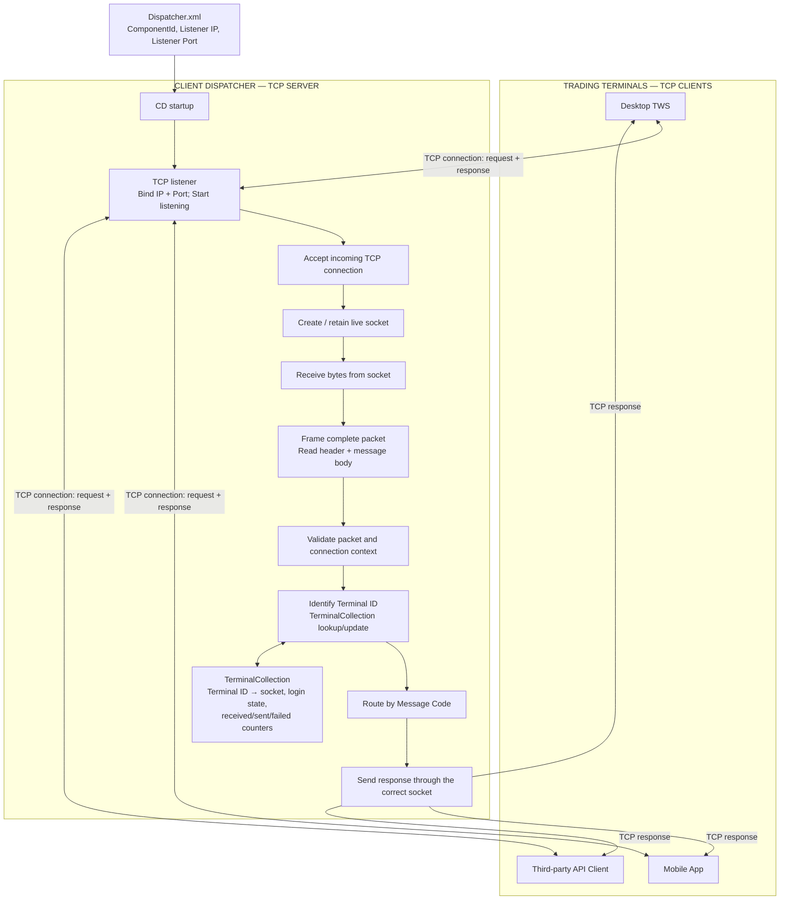

# Terminal ↔ Client Dispatcher (CD)
## Detailed Connection Diagram and Generic Implementation Algorithm

> **Scope:** This document covers only the connection between trading terminals and the Client Dispatcher. It intentionally excludes backend-server discovery and multicast.
>
> **Source-grounded facts from the supplied project screenshots:** The CD is a C# application with a TCP listener for terminals. Startup reads `Dispatcher.xml` for the `ComponentId`, listener IP/port and multicast settings. The CD maintains a `TerminalCollection` keyed by terminal ID. Packet headers contain message code, message length, error code, terminal/client ID and Client Dispatcher ID. Each terminal record stores the live socket, logged-in flag and received/sent/failed counters. Login state uses `RequestedConnectionContext` and `ConnectionContext`.
>
> **Generic design guidance:** The algorithms and pseudocode below describe a sound general way to implement this type of TCP service. They are not claimed to be the exact source-code implementation of your project.

---

# 1. High-level connection diagram



**Interpretation**

- Each terminal opens its own TCP connection to the CD's configured listener endpoint.
- The CD accepts each connection and obtains a socket for that connection.
- TCP is a byte stream. The CD must reconstruct complete application packets using the protocol's framing rules; one socket read is not guaranteed to equal one complete message.
- The terminal ID in the application header is used by the CD to associate messages with terminal state. The socket itself represents the actual network connection.
- The CD sends a response through the appropriate connection/socket. It should not choose a socket solely from an untrusted terminal ID without checking that the connection is authorized for that terminal/session.

# 2. Connection establishment sequence

```mermaid
sequenceDiagram
    participant Terminal
    participant CD as Client Dispatcher
    participant Registry as TerminalCollection

    Note over CD: Startup: read Dispatcher.xml
    Note over CD: Start TCP listener on configured IP and port

    Terminal->>CD: TCP connect(IP, Port)
    CD-->>Terminal: TCP connection established
    CD->>CD: Accept connection and obtain socket
    CD->>Registry: Create connection/session record (implementation-specific)
    Note over Terminal,CD: TCP is connected; user is NOT necessarily logged in

    loop While connection remains active
        Terminal->>CD: Application packet (header + body)
        CD->>CD: Read bytes and reconstruct complete packet
        CD->>CD: Validate header, length, message type and connection
        CD->>Registry: Find/update terminal state using Terminal ID
        CD->>CD: Process or route request
        CD-->>Terminal: Response on the corresponding TCP connection
    end

    opt Connection closes or fails
        Terminal--xCD: TCP close / network failure
        CD->>CD: Detect disconnect / send failure
        CD->>Registry: Mark or remove connection state safely
    end
```

# 3. What happens at each stage?

| Stage | Terminal side | Client Dispatcher side |
|---|---|---|
| Configuration | Knows the CD endpoint from its deployment/configuration | Reads listener IP and port from `Dispatcher.xml` |
| Connect | Opens a TCP connection to CD IP + port | Listener accepts the connection |
| Connected state | Keeps the socket available for communication | Retains the accepted socket and associates it with connection state |
| Send | Sends protocol packet bytes | Receives bytes from the socket |
| Packet framing | Sends data in the agreed protocol format | Reconstructs full packet using header/length rules |
| Identification | Includes the protocol's terminal/client identity fields | Reads Terminal ID and Client Dispatcher ID from header |
| Validation | Waits for response | Validates packet fields and applicable session/connection state |
| Processing | Sends login/order/report/etc. request | Routes by message code to the relevant handler |
| Response | Receives response | Sends reply through the correct terminal connection |
| Disconnect | Closes socket or loses network | Detects closure/failure and updates connection state |

## 3.1 TCP connection is not the same as login

This distinction is essential:

- **TCP connected:** a network connection/socket exists between terminal and CD.
- **Application logged in:** the Login Server has accepted the user's login and CD has established the authenticated connection state.

The project notes describe two slots:

- `RequestedConnectionContext`: the connection currently asking to log in.
- `ConnectionContext`: the officially logged-in connection.

On login success, the CD moves the requested connection into the logged-in slot and sends the response. On failure, it sends the error and clears the requested slot.

# 4. Packet format and framing

The screenshots identify these fixed-header fields:

| Header field | Purpose |
|---|---|
| Message Code | Identifies the kind of application message |
| Message Length | Indicates the message length according to the protocol |
| Error Code | Carries protocol/application error information |
| Client / Terminal ID | Identifies the terminal/client |
| Client Dispatcher ID | Identifies the CD associated with the message |

**Important TCP concept:** TCP does not preserve application-message boundaries. A single `Receive` can return part of a header, one full packet, or multiple packets together. The implementation must use the actual protocol framing rule (for example, a fixed header containing a length field) and read until a complete packet is available.

Do not invent byte offsets, field sizes, byte order, encryption details, or maximum packet size. Get those from the real protocol definitions/source code.

# 5. Generic algorithm — how to implement the terminal connection

This is a language-independent algorithm. Adapt it to the existing project's classes, packet definitions, queues and threading model.

## Algorithm A — Start the CD TCP listener

**Input:** `Dispatcher.xml`

**Output:** A running TCP listener ready to accept terminal connections.

1. Read the configuration file.
2. Extract and validate:
   - CD `ComponentId`
   - Listener IP address
   - Listener port
   - Any protocol/network settings required by the application
3. Check that the configuration is valid.
4. Check the project's duplicate-instance rule (the notes say the CD checks that another CD instance is not running from the same folder).
5. Create the TCP listener using the configured IP and port.
6. Bind the listener to the endpoint.
7. Start listening for incoming connections.
8. Start the connection-accept loop.
9. If startup fails, log the error and fail startup cleanly; do not report the listener as ready.

## Algorithm B — Accept a terminal connection

**Input:** A connection request received by the TCP listener.

**Output:** An accepted socket and a connection context.

1. Wait asynchronously for an incoming TCP connection.
2. When a connection is accepted, obtain the socket/client object.
3. Create a connection context for that accepted socket.
4. Initialize connection status as connected but **not authenticated**.
5. Initialize per-connection receive/send state and counters.
6. Start a receive/packet-processing task for this connection.
7. Return immediately to accepting other terminals; do not block the listener while one terminal is being processed.

## Algorithm C — Receive and reconstruct packets

**Input:** Bytes received from one terminal socket.

**Output:** Complete application packets.

1. Read bytes from the socket.
2. If the read indicates zero bytes, treat it as a graceful remote disconnect.
3. Append received bytes to that connection's receive buffer.
4. While the buffer contains enough bytes to identify a complete packet:
   1. Check whether the complete fixed header is available.
   2. Parse the header according to the actual protocol definition.
   3. Validate the declared message length and allowed bounds.
   4. If the full packet body has not arrived, wait for more bytes.
   5. If the full packet is available, extract exactly one packet.
   6. Leave any remaining bytes in the buffer for the next packet.
   7. Pass the complete packet to validation/dispatch.
5. Continue receiving until the connection closes or an unrecoverable error occurs.

## Algorithm D — Validate and identify the terminal

**Input:** Complete packet + connection context.

**Output:** Accepted packet associated with the correct terminal, or a protocol error.

1. Validate that the header is structurally valid.
2. Validate message code and message length.
3. Read Terminal ID and Client Dispatcher ID from the header.
4. Check that the packet is intended for this CD, using the project's identity rules.
5. Associate the packet with the accepted socket/connection context.
6. Look up the Terminal ID in `TerminalCollection`.
7. If this is a new/allowed connection, create or update its record according to the project's connection policy.
8. If the terminal already has a connection, apply the project's duplicate-connection/reconnect rules; do not silently overwrite a live session.
9. Update the received-message counter.
10. Check the login/session requirement for the message type.
11. Reject invalid or unauthorized requests using the project's defined error codes.
12. Send valid packets to the appropriate message handler/queue.

**Security rule:** Do not trust a Terminal ID in a packet as proof of identity by itself. Bind the identity to the accepted socket and authenticated session according to the actual application protocol.

## Algorithm E — Route a valid request

**Input:** Validated application packet.

**Output:** Request sent to the correct internal handler.

1. Read the Message Code.
2. Determine the message category.
3. Apply the correct session and authorization checks.
4. Put the packet onto the appropriate queue/worker path.
5. Process it using the matching handler.
6. Keep independent work pools isolated where the system design requires it (the project notes mention separate pools for login, orders, reports and mapping).
7. When a response is produced, preserve the information needed to identify the originating terminal connection.
8. Pass the response to the outbound sender.

This document focuses on terminal-to-CD connectivity; the backend routing destinations are intentionally not expanded here.

## Algorithm F — Send a response to the correct terminal

**Input:** Response packet + originating connection/session reference.

**Output:** Response bytes written to the correct TCP socket.

1. Resolve the correct active connection context.
2. Confirm that the socket is still connected/usable.
3. Build the response using the actual protocol header and body format.
4. Serialize the packet to bytes.
5. Use a per-connection send lock or a single-writer send queue so concurrent workers cannot interleave packet bytes on the same TCP stream.
6. Send all bytes; handle partial sends correctly.
7. Update the sent-message counter.
8. If sending fails, update the failed-message counter and invoke the connection-failure handling policy.
9. Never send a private response to a different terminal's socket.

## Algorithm G — Handle disconnect and cleanup

**Input:** Socket close, zero-byte read, or unrecoverable socket error.

**Output:** Consistent terminal/connection state.

1. Mark the affected connection as closing/closed.
2. Stop accepting new work for that connection where appropriate.
3. Cancel or finish its receive/send tasks safely.
4. Close and dispose the socket.
5. Update or remove the connection record in `TerminalCollection` using thread-safe synchronization.
6. Clear the relevant login/requested connection state only if it refers to this exact connection.
7. Do not accidentally clear a newer connection that has already reconnected.
8. Record the disconnect reason and update monitoring counters.
9. Allow a later terminal reconnect to follow the project's normal connection/login procedure.

# 6. End-to-end pseudocode

```text
MAIN:
    config = READ_CONFIGURATION("Dispatcher.xml")
    VALIDATE_CONFIGURATION(config)
    CHECK_DUPLICATE_CD_INSTANCE()

    listener = CREATE_TCP_LISTENER(config.ListenerIP, config.ListenerPort)
    listener.START()

    WHILE service_is_running:
        socket = AWAIT listener.ACCEPT_CONNECTION()
        connection = CREATE_CONNECTION_CONTEXT(socket)
        connection.authenticated = false
        INITIALIZE_CONNECTION_COUNTERS(connection)

        START_BACKGROUND_TASK(HANDLE_TERMINAL(connection))


HANDLE_TERMINAL(connection):
    buffer = CREATE_RECEIVE_BUFFER()

    TRY:
        WHILE connection.is_open:
            bytes = AWAIT RECEIVE(connection.socket)

            IF bytes.length == 0:
                BREAK   // remote endpoint closed connection

            buffer.APPEND(bytes)

            WHILE buffer.CONTAINS_COMPLETE_PACKET():
                packet = EXTRACT_ONE_COMPLETE_PACKET(buffer)

                IF NOT VALIDATE_HEADER_AND_LENGTH(packet):
                    SEND_PROTOCOL_ERROR_IF_SAFE(connection)
                    CLOSE_CONNECTION(connection)
                    RETURN

                terminal_id = packet.header.TerminalID
                cd_id = packet.header.ClientDispatcherID

                IF NOT VALIDATE_CD_ID(cd_id):
                    SEND_PROTOCOL_ERROR_IF_SAFE(connection)
                    CONTINUE

                terminal_record = FIND_OR_REGISTER_TERMINAL(
                    terminal_id,
                    connection
                )

                IF NOT VALIDATE_CONNECTION_OWNERSHIP(
                    terminal_record,
                    connection
                ):
                    SEND_AUTHORIZATION_OR_CONNECTION_ERROR(connection)
                    CONTINUE

                UPDATE_RECEIVED_COUNTER(terminal_record)

                IF MESSAGE_REQUIRES_LOGIN(packet) AND
                   NOT IS_AUTHENTICATED_CONNECTION(terminal_record, connection):
                    SEND_USER_NOT_LOGGED_IN(connection)
                    CONTINUE

                queue = SELECT_QUEUE_USING_MESSAGE_CODE(packet)
                ENQUEUE(queue, packet, connection)

    CATCH network_or_protocol_error:
        LOG_ERROR(network_or_protocol_error)

    FINALLY:
        CLEAN_UP_ONLY_THIS_CONNECTION(connection)


SEND_RESPONSE(response, originating_connection):
    IF originating_connection IS NOT ACTIVE:
        HANDLE_UNDELIVERABLE_RESPONSE(response)
        RETURN

    bytes = SERIALIZE_USING_PROJECT_PROTOCOL(response)

    ACQUIRE_SEND_LOCK(originating_connection)
    TRY:
        SEND_ALL_BYTES(originating_connection.socket, bytes)
        UPDATE_SENT_COUNTER(originating_connection)
    CATCH send_error:
        UPDATE_FAILED_COUNTER(originating_connection)
        MARK_CONNECTION_FOR_CLEANUP(originating_connection)
    FINALLY:
        RELEASE_SEND_LOCK(originating_connection)
```

# 7. Suggested code modules / responsibilities

A maintainable implementation can be separated into responsibilities like these. Names are illustrative; map them to the actual project structure rather than creating duplicate classes unnecessarily.

| Module / responsibility | What it does |
|---|---|
| Configuration loader | Reads `Dispatcher.xml`; validates listener settings and CD identity |
| TCP listener / acceptor | Binds to IP/port and accepts terminal sockets |
| Connection context | Holds one accepted socket and its per-connection state |
| Packet decoder / framer | Reconstructs complete packets from the TCP byte stream |
| Header / protocol validator | Validates header fields, message code and message length |
| Terminal registry | Maintains `TerminalCollection` and terminal connection state |
| Login/session manager | Manages requested and authenticated connection slots |
| Message router | Routes valid packets by message code |
| Outbound sender | Serializes and sends responses on the correct socket |
| Connection manager | Detects disconnects and performs safe cleanup |
| Monitoring / logging | Tracks connected terminals and received/sent/failed counts |

# 8. Implementation checklist

- [ ] Read and validate listener IP and port from `Dispatcher.xml`.
- [ ] Start the listener before accepting connections.
- [ ] Accept multiple terminals without blocking the accept loop.
- [ ] Maintain a distinct connection context for each accepted socket.
- [ ] Implement packet framing; never assume one socket read equals one packet.
- [ ] Validate header and message length before processing.
- [ ] Associate Terminal ID with the accepted socket and correct CD ID.
- [ ] Maintain `TerminalCollection` safely under concurrent access.
- [ ] Keep TCP-connected state separate from authenticated login state.
- [ ] Implement the `RequestedConnectionContext` / `ConnectionContext` transition on login success/failure.
- [ ] Route each response back to the originating, authorized connection.
- [ ] Serialize concurrent writes to each TCP socket.
- [ ] Handle partial sends, disconnects, timeouts and reconnects.
- [ ] Update received, sent and failed counters.
- [ ] Test multiple terminals, malformed packets, partial packets, multiple packets in one read, duplicate terminal IDs and abrupt disconnects.

# 9. Test scenarios

| Test | Expected behavior |
|---|---|
| One terminal connects | CD accepts and records its connection |
| Many terminals connect | Each gets its own connection context/socket |
| Terminal sends partial header | CD waits for remaining bytes |
| Terminal sends packet in several chunks | CD reconstructs one complete packet |
| Terminal sends several packets together | CD extracts and processes each packet |
| Invalid message length | CD rejects safely; does not allocate unbounded memory |
| Unknown or invalid terminal/session | CD follows the defined protocol error policy |
| TCP connected, not logged in | Login-required operations are rejected |
| Login succeeds | Requested connection becomes logged-in connection |
| Login fails | Requested slot is cleared and error is returned |
| Terminal disconnects | Only that connection's state is cleaned up |
| Terminal reconnects | New socket is treated as a new connection and follows session rules |
| Two workers respond at once | Writes do not interleave on the same socket |

# 10. What must be confirmed from your actual source code

The screenshots do **not** specify all implementation details. Before writing code in the existing project, inspect the code/configuration to confirm:

1. Exact `Dispatcher.xml` element names and listener configuration.
2. Whether the project uses `TcpListener`, raw `Socket`, or a custom network-shell abstraction.
3. Exact packet header size, field offsets, data types and byte order.
4. The precise message-length/framing rule and maximum packet size.
5. Whether encryption/decryption occurs before or after packet framing.
6. How `TerminalCollection` is synchronized across threads.
7. How duplicate connections and reconnects are handled.
8. How socket closure and heartbeat/timeout detection work.
9. How outbound sender threads preserve per-terminal ordering.
10. Which error codes and response formats are defined by the protocol.

**Key idea to remember:** The terminal opens a TCP connection; CD accepts and tracks the socket; the CD reconstructs and validates application packets; it associates them with the correct terminal/session; it processes the message and sends the response back through the correct connection.
